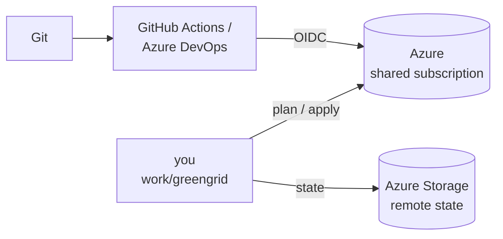

# Terraform on Microsoft Azure – Hands-on Labs

Twelve labs that take **GreenGrid**, an energy start-up, from portal clicks to tested, reviewed and automated infrastructure as code: Terraform 1.17 with azurerm 5 and AzAPI 2, remote state with Entra ID, meta-arguments and refactoring with `moved`, dynamic blocks, modules, import and drift, `terraform test` with mocked providers, tflint, ephemeral secrets, managed identities and CI/CD with OIDC in GitHub Actions or Azure DevOps.



## Labs

| # | Lab | You will… | Time |
|---|---|---|---|
| 01 | [First deployment](labs/LAB01-first-deployment/README.md) | set up, deploy a resource group and storage, read plans | 40 min |
| 02 | [Variables & locals](labs/LAB02-variables-locals/README.md) | validations, naming and tagging standards, tfvars per environment | 40 min |
| 03 | [Remote state](labs/LAB03-remote-state/README.md) | state in Azure Storage with Entra ID, migration, locking | 40 min |
| 04 | [Meta-arguments](labs/LAB04-meta-arguments/README.md) | count vs. for_each, `moved`, depends_on, lifecycle | 45 min |
| 05 | [Expressions & dynamic blocks](labs/LAB05-expressions-dynamic/README.md) | complex types, `for` expressions, dynamic NSG rules, conditionals | 45 min |
| 06 | [Modules](labs/LAB06-modules/README.md) | network and storage modules, refactoring with `moved`, AVM | 50 min |
| 07 | [Import & drift](labs/LAB07-import-drift/README.md) | `import` blocks with generated config, drift, `removed` | 40 min |
| 08 | [Testing & quality](labs/LAB08-testing-quality/README.md) | `terraform test` with mocks, check blocks, tflint | 45 min |
| 09 | [AzAPI](labs/LAB09-azapi/README.md) | any ARM resource and API version with AzAPI 2.x | 35 min |
| 10 | [Secrets & identity](labs/LAB10-secrets-identity/README.md) | Key Vault, ephemeral values, write-only attributes, managed identity | 45 min |
| 11 | [CI/CD](labs/LAB11-cicd/README.md) | plan on pull requests, apply after approval, OIDC – GitHub or Azure DevOps | 50 min |
| 12 | [Break-fix challenge](labs/LAB12-break-fix/README.md) | eight broken configurations to diagnose and fix | 40 min |

## Prerequisites

- **Terraform 1.14 or newer** (verified with 1.17.1), **Azure CLI**, `git` – or use Azure Cloud Shell
- Optional: **tflint** (LAB08), Graphviz (`terraform graph`), `jq`
- An Azure subscription for the training – everybody shares one and uses a personal **prefix** (2–8 lowercase letters/digits)
- Permissions in that subscription: **Contributor** and **Role Based Access Control Administrator** (labs create role assignments) – or Owner in a sandbox subscription
- LAB11: a GitHub account **or** an Azure DevOps project

## Quick start

```bash
git clone <this repository> terraform-azure-labs && cd terraform-azure-labs
chmod +x bin/*
az login && export ARM_SUBSCRIPTION_ID=$(az account show --query id -o tsv)
mkdir -p work/greengrid      # your working copy - LAB01 starts here
```

Fell behind? `./bin/catchup <N>` puts the reference solution of lab N into `work/greengrid` (your prefix, state and `backend.hcl` are kept).

## Repository layout

```
labs/            lab instructions
solutions/       reference code per lab (LAB01 ... LAB11) - every one passes fmt, validate and mocked tests
break-fix/       LAB12 scenarios (+ mocks)
bin/catchup      copy a reference solution into work/greengrid
bin/check-breakfix.sh   score the LAB12 challenge
work/            your code (not in Git)
```

Verified with Terraform 1.17.1, azurerm 5.12, AzAPI 2.13, random 3.9 and tflint 0.65 (azurerm ruleset 0.33).

## Clean up

At the end of the course: `cd work/greengrid && terraform destroy -var-file=env/dev.tfvars`, then delete the state resource group (`az group delete -n rg-<prefix>-tfstate`) and the pipeline identity.

## License

MIT – see [LICENSE](LICENSE).
