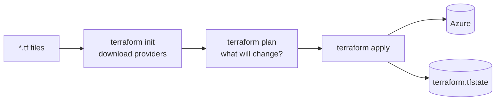

# LAB 01 – Setup and your first deployment

> **Story:** You join *GreenGrid*, an energy start-up that collects smart-meter readings. Its Azure estate was clicked together in the portal – nobody can rebuild it, nobody knows who changed what. Your mission for the next two days: everything as code, with Terraform.

| | |
|---|---|
| **Duration** | ~40 min |
| **You create** | `work/greengrid/` – versions, provider, a resource group and a storage account |
| **Solution** | `solutions/LAB01/` (or `./bin/catchup 1`) |



## Step 1 – Tools and login

You need Terraform **1.14 or newer** and the Azure CLI. Azure Cloud Shell has both; locally use any terminal (the examples are bash – PowerShell differences are noted).

```bash
terraform version          # >= 1.14
az version
az login
az account list -o table
az account set --subscription "<training subscription>"
```

Since azurerm 4.0 the provider **must** know the subscription. Export it once per terminal:

```bash
export ARM_SUBSCRIPTION_ID=$(az account show --query id -o tsv)
# PowerShell: $env:ARM_SUBSCRIPTION_ID = (az account show --query id -o tsv)
```

> **Shared subscription:** everybody works in one subscription. Choose a **prefix** – 2–8 lowercase letters or digits, unique in the group (e.g. your initials: `jk`, `am3`). It goes into every resource name.

## Step 2 – The project

```bash
mkdir -p work/greengrid && cd work/greengrid
```

`versions.tf` – which Terraform and which providers, pinned:

```hcl
terraform {
  required_version = ">= 1.14.0, < 2.0.0"

  required_providers {
    azurerm = {
      source  = "hashicorp/azurerm"
      version = "~> 5.12"
    }
    random = {
      source  = "hashicorp/random"
      version = "~> 3.9"
    }
  }
}
```

`providers.tf`:

```hcl
# The subscription comes from ARM_SUBSCRIPTION_ID - required since azurerm 4.0.
# Authentication: your `az login` session locally, OIDC in pipelines (LAB11).
provider "azurerm" {
  features {}
}
```

`variables.tf`:

```hcl
variable "prefix" {
  type        = string
  description = "Your personal prefix (2-8 lowercase letters/digits) - unique in the shared subscription"
}

variable "location" {
  type        = string
  description = "Azure region"
  default     = "westeurope"
}
```

`main.tf`:

```hcl
resource "azurerm_resource_group" "main" {
  name     = "rg-${var.prefix}-greengrid"
  location = var.location
}

# Storage account names are global: add a random suffix
resource "random_string" "suffix" {
  length  = 4
  upper   = false
  special = false
}

resource "azurerm_storage_account" "data" {
  name                     = "st${var.prefix}gg${random_string.suffix.result}"
  resource_group_name      = azurerm_resource_group.main.name
  location                 = azurerm_resource_group.main.location
  account_tier             = "Standard"
  account_replication_type = "LRS"
  min_tls_version          = "TLS1_2"
}
```

`outputs.tf`:

```hcl
output "resource_group_name" {
  value = azurerm_resource_group.main.name
}

output "storage_account_name" {
  value = azurerm_storage_account.data.name
}
```

`terraform.tfvars` – your values (Terraform loads this file automatically):

```hcl
prefix = "jk"   # <- your own prefix
```

## Step 3 – init, fmt, validate, plan, apply

```bash
terraform init          # downloads azurerm and random, writes .terraform.lock.hcl
terraform fmt           # canonical formatting
terraform validate      # syntax and types - no Azure call
terraform plan
```

Read the plan before anything else:

| Symbol | Meaning |
|---|---|
| `+` | create |
| `~` | update in place |
| `-/+` | **destroy and re-create** (replacement – read twice!) |
| `-` | destroy |

✅ **Checkpoint:** `Plan: 3 to add, 0 to change, 0 to destroy.`

```bash
terraform apply         # type "yes"
terraform output
az resource list -g rg-<prefix>-greengrid -o table
```

✅ **Checkpoint:** the resource group and the storage account exist; `terraform output` shows their names.

> Why does the storage account wait for the resource group? `resource_group_name = azurerm_resource_group.main.name` is a reference – Terraform builds its dependency graph from references. See it: `terraform graph | dot -Tsvg > graph.svg` (needs Graphviz).

## Step 4 – A change, and a replacement

1. Add tags to the resource group:

   ```hcl
     tags = {
       project = "greengrid"
       owner   = "<your name>"
     }
   ```

   `terraform plan` → `~ update in-place`. Apply.

2. Change `account_replication_type` to `"GRS"` and plan – update in place. Now change the **location** of the storage account to `"northeurope"` and plan:

   ✅ **Checkpoint:** `-/+ must be replaced` – Azure cannot move a storage account; Terraform would delete the data. **Do not apply** – revert both changes.

## Step 5 – Look at the state

```bash
terraform state list
terraform state show azurerm_storage_account.data
```

`terraform.tfstate` maps your code to real Azure IDs – and contains secrets (storage keys!). Never commit it. LAB03 moves it to Azure.

> Keep the resources – the next labs build on them. Destroy at the end of the course (`terraform destroy`).

## Troubleshooting

| Symptom | Likely cause |
|---|---|
| `subscription ID could not be determined` | `ARM_SUBSCRIPTION_ID` not exported in this terminal |
| `StorageAccountAlreadyTaken` | storage names are global – another prefix or a new random suffix (`terraform apply -replace=random_string.suffix`) |
| `name can only consist of lowercase letters and numbers` | prefix with uppercase letters or `-` |
| `AuthorizationFailed` | wrong subscription selected (`az account show`) |
| `Unsupported Terraform Core version` | Terraform older than 1.14 |
