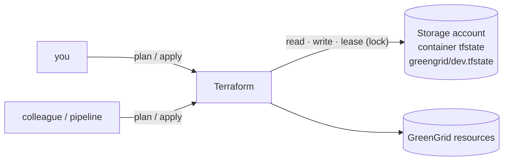

# LAB 03 – Remote state in Azure Storage

> **Story:** A colleague wants to fix a tag on GreenGrid's storage – but the state is on your laptop. Two people, two states, one subscription: a recipe for disaster. The state moves to Azure, protected by locking and Entra ID.

| | |
|---|---|
| **Duration** | ~40 min |
| **You create** | a state storage account (Azure CLI), `backend.tf`, `backend.hcl` |
| **Solution** | `solutions/LAB03/` (or `./bin/catchup 3`) |



## Step 1 – Bootstrap the state storage (once, with the Azure CLI)

The backend must exist before Terraform can use it – it is created outside the configuration it stores.

```bash
P=jk                                            # <- your prefix
RG=rg-$P-tfstate
SA=st${P}tfstate$RANDOM                         # must be globally unique
az group create -n $RG -l westeurope -o none
az storage account create -n $SA -g $RG -l westeurope --sku Standard_ZRS \
  --min-tls-version TLS1_2 --allow-blob-public-access false \
  --allow-shared-key-access false -o none        # Entra ID only, no account keys
az storage account blob-service-properties update -n $SA -g $RG --enable-versioning true -o none
az role assignment create --assignee "$(az ad signed-in-user show --query id -o tsv)" \
  --role "Storage Blob Data Contributor" --scope "$(az storage account show -n $SA -g $RG --query id -o tsv)" -o none
az storage container create -n tfstate --account-name $SA --auth-mode login -o none
echo "state storage: $SA"
```

> Versioning keeps every previous state – your undo button if a state ever gets corrupted. Role assignments can take a minute to become effective; repeat the last command if it fails with `AuthorizationPermissionMismatch`.

## Step 2 – Backend configuration

`backend.tf` – only what is the same for everybody:

```hcl
# Remote state in Azure Storage. Values come from backend.hcl (partial configuration),
# so the same code works for every participant and every environment:
#   terraform init -backend-config=backend.hcl
terraform {
  backend "azurerm" {
    use_azuread_auth = true # Entra ID instead of storage account keys
  }
}
```

`backend.hcl` – your values (not committed, see `.gitignore`):

```hcl
resource_group_name  = "rg-jk-tfstate"
storage_account_name = "stjktfstate12345"
container_name       = "tfstate"
key                  = "greengrid/dev.tfstate"
```

## Step 3 – Migrate the local state

```bash
terraform init -backend-config=backend.hcl -migrate-state
```

Answer `yes` to *Do you want to copy existing state to the new backend?*

```bash
az storage blob list --account-name $SA -c tfstate --auth-mode login -o table
terraform plan -var-file=env/dev.tfvars
```

✅ **Checkpoint:** the blob `greengrid/dev.tfstate` exists and the plan says **No changes** – same state, new home. Delete the local leftovers: `rm terraform.tfstate terraform.tfstate.backup`.

## Step 4 – Locking

Open a second terminal in the same folder (export `ARM_SUBSCRIPTION_ID` there too).

- Terminal 1: `terraform apply -var-file=env/dev.tfvars` – **do not answer yet**.
- Terminal 2: `terraform plan -var-file=env/dev.tfvars`

✅ **Checkpoint:** terminal 2 fails with `Error acquiring the state lock` and shows who holds the lock. The azurerm backend uses a **blob lease** – no extra table or service needed. Answer `no` in terminal 1.

> A crashed run can leave a lock behind: `terraform force-unlock <LOCK_ID>` – only when you are sure nobody is running.

## Step 5 – State commands

```bash
terraform state list
terraform state show azurerm_resource_group.main
terraform state pull | head -20        # the raw JSON - treat it as secret
terraform show -json | jq '.values.root_module.resources | length'
```

| Command | Use it for |
|---|---|
| `state list` / `show` | what Terraform manages |
| `state mv` | rename in state – prefer `moved` blocks (LAB04) |
| `state rm` | forget a resource – prefer `removed` blocks (LAB07) |
| `import` | adopt an existing resource – prefer `import` blocks (LAB07) |
| `force-unlock` | clean up a stale lock |

## Bonus

- One state per environment: create `backend-prod.hcl` with `key = "greengrid/prod.tfstate"` and switch with `terraform init -reconfigure -backend-config=backend-prod.hcl`. Why are separate states safer than workspaces for prod?
- Read another configuration's outputs: `data "terraform_remote_state"` – and why most teams prefer passing values via data sources or Key Vault instead.

## Troubleshooting

| Symptom | Likely cause |
|---|---|
| `AuthorizationPermissionMismatch` / 403 | the *Storage Blob Data Contributor* role is missing or not yet effective – wait a minute |
| `Key based authentication is not permitted` | `use_azuread_auth = true` missing in `backend.tf` |
| `Backend configuration changed` | you changed `backend.hcl` – run `terraform init -reconfigure` (new state) or `-migrate-state` (copy) |
| plan wants to create everything again | wrong `key` in `backend.hcl` – you are looking at an empty state |
