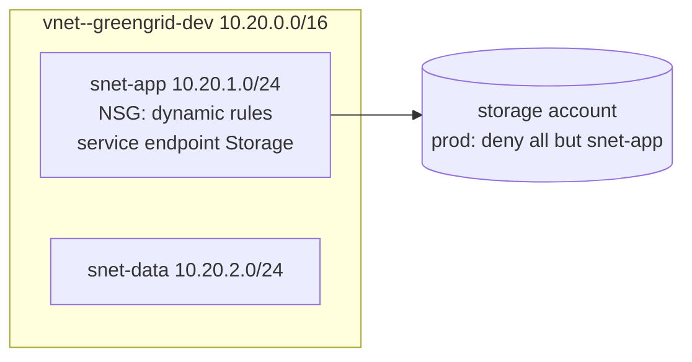

# LAB 05 – Complex types, expressions and dynamic blocks

> **Story:** The meter-reading API needs a network: a VNet, an *app* and a *data* subnet, firewall rules owned by the security team as data – and in production the storage account must only accept traffic from the app subnet.

| | |
|---|---|
| **Duration** | ~45 min |
| **You create** | `network.tf`; you edit `variables.tf`, `locals.tf`, `main.tf`, `outputs.tf` |
| **Solution** | `solutions/LAB05/` (or `./bin/catchup 5`) |



## Step 1 – Typed inputs

Append to `variables.tf`:

```hcl
variable "address_space" {
  type        = list(string)
  description = "Address space of the GreenGrid virtual network"
  default     = ["10.20.0.0/16"]

  validation {
    condition     = alltrue([for cidr in var.address_space : can(cidrhost(cidr, 0))])
    error_message = "Every address_space entry must be a valid CIDR, e.g. 10.20.0.0/16."
  }
}

variable "subnets" {
  type = map(object({
    cidr              = string
    service_endpoints = optional(list(string), [])
  }))
  description = "Subnets keyed by name"
  default = {
    app  = { cidr = "10.20.1.0/24", service_endpoints = ["Microsoft.Storage"] }
    data = { cidr = "10.20.2.0/24" }
  }
}

variable "nsg_rules" {
  type = map(object({
    priority = number
    port     = string
    source   = string
    access   = optional(string, "Allow")
    protocol = optional(string, "Tcp")
  }))
  description = "Inbound rules for the app subnet, keyed by rule name"
  default = {
    allow-https = { priority = 100, port = "443", source = "Internet" }
    allow-api   = { priority = 110, port = "8080", source = "VirtualNetwork" }
  }

  validation {
    condition     = alltrue([for r in values(var.nsg_rules) : r.priority >= 100 && r.priority <= 4096])
    error_message = "NSG rule priorities must be between 100 and 4096."
  }
}

variable "allowed_ips" {
  type        = list(string)
  description = "Public IPs allowed to reach the storage account (e.g. your laptop)"
  default     = []
}
```

`optional(type, default)` lets callers skip attributes – the object still has them, with the default.

In `locals.tf` add `is_prod = var.environment == "prod"`.

## Step 2 – Network with dynamic blocks

`network.tf`:

```hcl
resource "azurerm_virtual_network" "main" {
  name                = "vnet-${local.name_suffix}"
  resource_group_name = azurerm_resource_group.main.name
  location            = azurerm_resource_group.main.location
  address_space       = var.address_space
  tags                = local.common_tags
}

resource "azurerm_subnet" "this" {
  for_each             = var.subnets
  name                 = "snet-${each.key}"
  resource_group_name  = azurerm_resource_group.main.name
  virtual_network_name = azurerm_virtual_network.main.name
  address_prefixes     = [each.value.cidr]

  dynamic "service_endpoint" {
    for_each = toset(each.value.service_endpoints)
    content {
      service = service_endpoint.value
    }
  }
}

resource "azurerm_network_security_group" "app" {
  name                = "nsg-app-${local.name_suffix}"
  resource_group_name = azurerm_resource_group.main.name
  location            = azurerm_resource_group.main.location
  tags                = local.common_tags

  dynamic "security_rule" {
    for_each = var.nsg_rules
    content {
      name                       = security_rule.key
      priority                   = security_rule.value.priority
      direction                  = "Inbound"
      access                     = security_rule.value.access
      protocol                   = security_rule.value.protocol
      source_port_range          = "*"
      destination_port_range     = security_rule.value.port
      source_address_prefix      = security_rule.value.source
      destination_address_prefix = "*"
    }
  }
}

resource "azurerm_subnet_network_security_group_association" "app" {
  subnet_id                 = azurerm_subnet.this["app"].id
  network_security_group_id = azurerm_network_security_group.app.id
}
```

> Since azurerm 5.0 service endpoints are `service_endpoint` **blocks** – the old `service_endpoints = [...]` list is gone. A dynamic block generates one block per element; inside it the iterator is named after the block (`service_endpoint.value`) unless you set `iterator = ...`.

## Step 3 – Conditional network rules on the storage account

In `main.tf`, inside the storage account:

```hcl
  network_rules {
    default_action             = local.is_prod ? "Deny" : "Allow"
    bypass                     = ["AzureServices"]
    ip_rules                   = var.allowed_ips
    virtual_network_subnet_ids = [azurerm_subnet.this["app"].id]
  }
```

Outputs built with `for` expressions:

```hcl
output "subnet_ids" {
  description = "Subnet IDs keyed by subnet name"
  value       = { for name, s in azurerm_subnet.this : name => s.id }
}

output "nsg_rule_ports" {
  description = "Open ports on the app subnet"
  value       = sort([for r in values(var.nsg_rules) : r.port])
}
```

```bash
terraform apply -var-file=env/dev.tfvars
```

✅ **Checkpoint:** VNet, two subnets, NSG with 2 rules associated with `snet-app`; `terraform output subnet_ids` shows both IDs.

## Step 4 – Change the rules as data

In `env/dev.tfvars` the security team overrides the rules:

```hcl
nsg_rules = {
  allow-https   = { priority = 100, port = "443", source = "Internet" }
  allow-api     = { priority = 110, port = "8443", source = "VirtualNetwork" }
  allow-metrics = { priority = 120, port = "9100", source = "10.20.2.0/24" }
}
```

✅ **Checkpoint:** the plan shows **one update in place** of the NSG – one rule changed, one added. Keys (`allow-api`) keep rules stable; with a list instead of a map, a new rule in the middle would rewrite all following rules.

Try `priority = 50` – the validation stops it.

## Step 5 – Expressions in the console

```bash
terraform console -var-file=env/dev.tfvars
```

```hcl
[for name, s in var.subnets : "${name}: ${s.cidr}"]
{ for name, s in var.subnets : name => s.cidr if length(s.service_endpoints) > 0 }
[for r in var.nsg_rules : r.port if r.source == "Internet"]
var.subnets["data"].service_endpoints
flatten([for s in values(var.subnets) : s.service_endpoints])
cidrsubnets("10.20.0.0/16", 8, 8, 8)
```

## Bonus

- Plan `env/prod.tfvars` with `allowed_ips = ["<your public IP>"]` (`curl -s ifconfig.me`): `Deny` + your IP + the subnet.
- Build the `subnets` map with `cidrsubnet()` from a list of names instead of hard-coded CIDRs.

## Troubleshooting

| Symptom | Likely cause |
|---|---|
| `Unsupported argument "service_endpoints"` | azurerm 5 – use the `service_endpoint` block |
| `Reference to undeclared resource "rule"` | the dynamic block iterator is `security_rule`, not `rule` (or add `iterator = rule`) |
| NSG rule `SecurityRuleConflict` | two rules with the same priority |
| storage returns 403 after switching to prod | `Deny` blocks your laptop – add your IP to `allowed_ips` |
