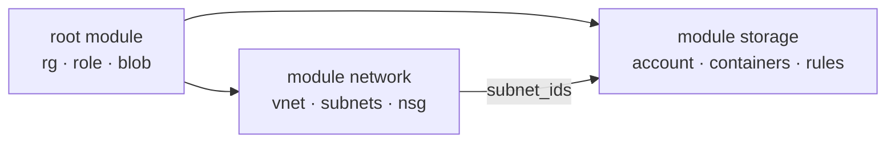

# LAB 06 – Modules: refactoring without downtime

> **Story:** A second GreenGrid team wants "the same network and storage, please". Copy-paste would fork the standards. You turn the code into two modules – and move the existing resources into them without re-creating anything.

| | |
|---|---|
| **Duration** | ~50 min |
| **You create** | `modules/network/`, `modules/storage/`, `moved.tf`; you rewrite `main.tf`, `outputs.tf`, remove `network.tf` |
| **Solution** | `solutions/LAB06/` (or `./bin/catchup 6`) |



## Step 1 – Interface first

A module is a folder of `.tf` files. Design the contract before the code:

| Module | Inputs | Outputs |
|---|---|---|
| `network` | `name_suffix`, `resource_group_name`, `location`, `tags`, `address_space`, `subnets`, `nsg_rules`, `nsg_subnet` | `vnet_id`, `subnet_ids` |
| `storage` | `name` (validated), `resource_group_name`, `location`, `tags`, `replication_type`, `zones`, `enable_archive`, `default_network_action`, `allowed_ips`, `allowed_subnet_ids` | `id`, `name`, `primary_blob_endpoint`, `container_ids` |

Modules get everything through variables – no `var.prefix` or `local.common_tags` from the root inside a module.

## Step 2 – The network module

```bash
mkdir -p modules/network modules/storage
git mv network.tf modules/network/main.tf 2>/dev/null || mv network.tf modules/network/main.tf
```

In `modules/network/main.tf` replace root references with variables:

| Root reference | Module reference |
|---|---|
| `local.name_suffix` | `var.name_suffix` |
| `azurerm_resource_group.main.name` | `var.resource_group_name` |
| `azurerm_resource_group.main.location` | `var.location` |
| `local.common_tags` | `var.tags` |
| `azurerm_virtual_network.main` | `azurerm_virtual_network.this` (rename the resource) |
| `azurerm_subnet.this["app"]` | `azurerm_subnet.this[var.nsg_subnet]` |

Copy `variables.tf` and `outputs.tf` for the module from `solutions/LAB06/modules/network/` – or write them from the interface table (the `subnets` and `nsg_rules` types are the ones from LAB05).

## Step 3 – The storage module

Move the storage account and both container resources from `main.tf` into `modules/storage/main.tf`; rename the account to `azurerm_storage_account.this` and use `var.*` for name, location, tags, replication and the network rules. Take `variables.tf` / `outputs.tf` from `solutions/LAB06/modules/storage/` – note the name validation inside the module: a module protects itself.

> Delete the three `moved` blocks from LAB04 (count → for_each) – everybody applied them already.

## Step 4 – Call the modules

New root `main.tf`:

```hcl
resource "azurerm_resource_group" "main" {
  name     = "rg-${local.name_suffix}"
  location = var.location
  tags     = local.common_tags
}

resource "random_string" "suffix" {
  length  = 4
  upper   = false
  special = false
}

module "network" {
  source = "./modules/network"

  name_suffix         = local.name_suffix
  resource_group_name = azurerm_resource_group.main.name
  location            = azurerm_resource_group.main.location
  tags                = local.common_tags
  address_space       = var.address_space
  subnets             = var.subnets
  nsg_rules           = var.nsg_rules
}

module "storage" {
  source = "./modules/storage"

  name                   = local.storage_name
  resource_group_name    = azurerm_resource_group.main.name
  location               = azurerm_resource_group.main.location
  tags                   = local.common_tags
  replication_type       = local.is_prod ? "ZRS" : "LRS"
  zones                  = var.data_zones
  enable_archive         = var.enable_archive
  default_network_action = local.is_prod ? "Deny" : "Allow"
  allowed_ips            = var.allowed_ips
  allowed_subnet_ids     = [module.network.subnet_ids["app"]]
}
```

Keep the role assignment and the README blob in the root, now pointing at `module.storage.id` and `module.storage.container_ids["raw"]`. Update `outputs.tf` to read from `module.network` / `module.storage`.

```bash
terraform init            # modules must be installed, too
terraform plan -var-file=env/dev.tfvars
```

✅ **Checkpoint (the scary one):** the plan wants to **destroy** the VNet, subnets, NSG, storage account and containers and create them again under new addresses. **Do not apply.**

## Step 5 – moved blocks

`moved.tf`:

```hcl
moved {
  from = azurerm_virtual_network.main
  to   = module.network.azurerm_virtual_network.this
}

moved {
  from = azurerm_subnet.this
  to   = module.network.azurerm_subnet.this
}

moved {
  from = azurerm_network_security_group.app
  to   = module.network.azurerm_network_security_group.app
}

moved {
  from = azurerm_subnet_network_security_group_association.app
  to   = module.network.azurerm_subnet_network_security_group_association.app
}

moved {
  from = azurerm_storage_account.data
  to   = module.storage.azurerm_storage_account.this
}

moved {
  from = azurerm_storage_container.zone
  to   = module.storage.azurerm_storage_container.zone
}

moved {
  from = azurerm_storage_container.archive
  to   = module.storage.azurerm_storage_container.archive
}
```

✅ **Checkpoint:** `0 to add, 0 to change, 0 to destroy` – only *has moved to* lines. Apply. Your data never noticed the refactoring.

## Step 6 – Modules from a registry

You do not have to write every module yourself. **Azure Verified Modules (AVM)** are Microsoft-maintained, tested modules:

```hcl
module "vnet" {
  source  = "Azure/avm-res-network-virtualnetwork/azurerm"
  version = "~> 0.x"   # always pin
  # ...
}
```

Look at one on registry.terraform.io (`Azure/avm-res-storage-storageaccount/azurerm`): inputs, outputs, examples, the azurerm version it needs. Discuss: when your own module, when AVM, when a fork?

## Bonus

- Use the network module a second time (`module "network_mgmt"`) with another address space – that is the payoff.
- Add a `README.md` per module; `terraform-docs markdown table modules/storage` generates the input/output tables.
- Version modules with Git tags: `source = "git::https://github.com/<org>/tf-modules.git//storage?ref=v1.2.0"`.

## Troubleshooting

| Symptom | Likely cause |
|---|---|
| `Module not installed` | run `terraform init` after adding a module |
| `Unsupported argument` in a module call | the input is not declared in the module's `variables.tf` |
| plan still destroys after adding moved | a `from` address has a typo – compare with `terraform state list` |
| `Moved object still exists` | the old resource block is still in the root |
