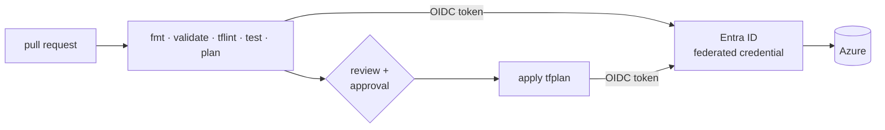

# LAB 11 – CI/CD: plan on every pull request, apply after approval

> **Story:** "terraform apply from a laptop" ends today. GreenGrid's infrastructure changes go through pull requests: the pipeline runs format, validation, tests and a plan; a reviewer approves; the pipeline applies exactly the reviewed plan – with **no stored secret** anywhere.

| | |
|---|---|
| **Duration** | ~50 min |
| **Requires** | a GitHub repository **or** an Azure DevOps project |
| **You use** | `solutions/LAB11/.github/workflows/terraform.yml` or `solutions/LAB11/azure-pipelines.yml` |

Pick **one track** (or both if you are fast).



## Step 1 – An identity for the pipeline (both tracks)

A user-assigned managed identity – no client secret, no expiry:

```bash
P=jk                                          # <- your prefix
RG=rg-$P-greengrid-dev
az identity create -g $RG -n id-$P-pipeline -o none
CLIENT_ID=$(az identity show -g $RG -n id-$P-pipeline --query clientId -o tsv)
PRINCIPAL_ID=$(az identity show -g $RG -n id-$P-pipeline --query principalId -o tsv)
SUB_ID=$(az account show --query id -o tsv); TENANT_ID=$(az account show --query tenantId -o tsv)

# what the pipeline may do - nothing outside your resource groups
for rg in rg-$P-greengrid-dev rg-$P-legacy; do
  az role assignment create --assignee-object-id $PRINCIPAL_ID --assignee-principal-type ServicePrincipal \
    --role "Contributor" --scope /subscriptions/$SUB_ID/resourceGroups/$rg -o none
  az role assignment create --assignee-object-id $PRINCIPAL_ID --assignee-principal-type ServicePrincipal \
    --role "Role Based Access Control Administrator" --scope /subscriptions/$SUB_ID/resourceGroups/$rg -o none
done
# the state
az role assignment create --assignee-object-id $PRINCIPAL_ID --assignee-principal-type ServicePrincipal \
  --role "Storage Blob Data Contributor" \
  --scope "$(az storage account show -n <state storage account> --query id -o tsv)" -o none
echo "CLIENT_ID=$CLIENT_ID  TENANT_ID=$TENANT_ID  SUB_ID=$SUB_ID"
```

> The code creates role assignments (LAB04, LAB10) – that is why the pipeline needs *Role Based Access Control Administrator*, scoped to its own resource groups only.

Prepare the repository content:

```bash
cd work/greengrid
cp ../../solutions/LAB11/.gitignore .
git init -b main && git add . && git commit -m "GreenGrid infrastructure"
```

Commit `backend.hcl` and `.terraform.lock.hcl` as well – the pipeline needs both (`git add -f backend.hcl`). `backend.hcl` holds names, not secrets.

---

## Track A – GitHub Actions

### A1 – Trust GitHub's tokens

```bash
REPO=<github-user>/greengrid-infra
for subject in "repo:$REPO:pull_request" "repo:$REPO:ref:refs/heads/main" "repo:$REPO:environment:dev"; do
  az identity federated-credential create -g $RG --identity-name id-$P-pipeline \
    -n "gh-$(echo $subject | tr ':/' '--' | cut -c1-60)" \
    --issuer https://token.actions.githubusercontent.com --subject "$subject" \
    --audiences api://AzureADTokenExchange -o none
done
```

The **subject** says exactly which workflow runs may log in: pull requests of this repository, runs on its `main` branch (the plan after a merge), and jobs in its `dev` environment (the apply).

### A2 – Repository settings

1. Create a **private** repository `greengrid-infra`, push `work/greengrid` to it.
2. **Settings → Secrets and variables → Actions → Variables**: `AZURE_CLIENT_ID`, `AZURE_TENANT_ID`, `AZURE_SUBSCRIPTION_ID` – variables, not secrets: these IDs are not sensitive.
3. **Settings → Environments → New environment** `dev` → **Required reviewers**: yourself (or your neighbour).
4. Copy the workflow: `mkdir -p .github/workflows && cp ../../solutions/LAB11/.github/workflows/terraform.yml .github/workflows/`.

### A3 – Read the workflow

- `permissions: id-token: write` – the job may request an OIDC token.
- `ARM_USE_OIDC: "true"` – azurerm, azapi **and** the azurerm backend exchange it for an Entra ID token.
- `plan` job: fmt → init → validate → test → plan → upload `tfplan` as an artifact; the plan is shown in the run summary.
- `apply` job: only on `main`, in environment `dev` (= approval), applies **the uploaded plan** – not a new one.

### A4 – Run it

```bash
git checkout -b feature/metrics-port
# change something visible, e.g. a new NSG rule in env/dev.tfvars
git commit -am "Open the metrics port" && git push -u origin feature/metrics-port
```

Open a pull request. ✅ **Checkpoint:** the *plan* job is green and the summary shows the plan. Merge – the *apply* job waits for your approval; approve; the change reaches Azure.

---

## Track B – Azure DevOps

### B1 – Service connection with workload identity federation

**Project settings → Service connections → New → Azure Resource Manager → Workload identity federation (manual)**:

- name **`greengrid-azure`**, scope: subscription `$SUB_ID`
- Azure DevOps shows an **issuer** and a **subject** – create the federated credential with them:

```bash
az identity federated-credential create -g $RG --identity-name id-$P-pipeline -n azdo-greengrid \
  --issuer "<issuer from Azure DevOps>" --subject "<subject from Azure DevOps>" \
  --audiences api://AzureADTokenExchange -o none
```

- back in Azure DevOps: client ID = `$CLIENT_ID`, tenant ID = `$TENANT_ID` → **Verify and save**.

### B2 – Environment with approval

**Pipelines → Environments → New** `dev` → **⋮ → Approvals and checks → Approvals**: yourself.

### B3 – Pipeline

Push `work/greengrid` with `azure-pipelines.yml` (`cp ../../solutions/LAB11/azure-pipelines.yml .`) to an Azure Repos repository, then **Pipelines → New → Azure Repos Git → Existing YAML**.

- `AzureCLI@2` with `addSpnToEnvironment: true` exposes `servicePrincipalId`, `tenantId` and `idToken`.
- They become `ARM_CLIENT_ID`, `ARM_TENANT_ID`, `ARM_OIDC_TOKEN` + `ARM_USE_OIDC=true` for Terraform.
- Stage *apply* is a deployment job in environment `dev` → the approval gate.

✅ **Checkpoint:** a run on `main` stops before *apply* and waits for approval; after approval it applies the published `tfplan`.

---

## Discussion

- Plan as an artifact: why must apply use the reviewed plan, and what happens if `main` changed meanwhile? (Terraform refuses a stale plan.)
- Drift detection: a scheduled pipeline running `terraform plan -detailed-exitcode` (exit code 2 = changes) every night.
- Promotion dev → prod: one pipeline with stages and separate state keys/identities per environment.

## Troubleshooting

| Symptom | Likely cause |
|---|---|
| `AADSTS700213: No matching federated identity record found` | subject differs – check repo name, branch/environment, case |
| backend `403` in the pipeline | the identity lacks *Storage Blob Data Contributor* on the state account |
| `Saved plan is stale` | something changed the state after the plan – re-run the pipeline |
| `Error: Inconsistent dependency lock file` | `.terraform.lock.hcl` not committed |
| role assignment fails in apply | missing *Role Based Access Control Administrator* on the resource group |
